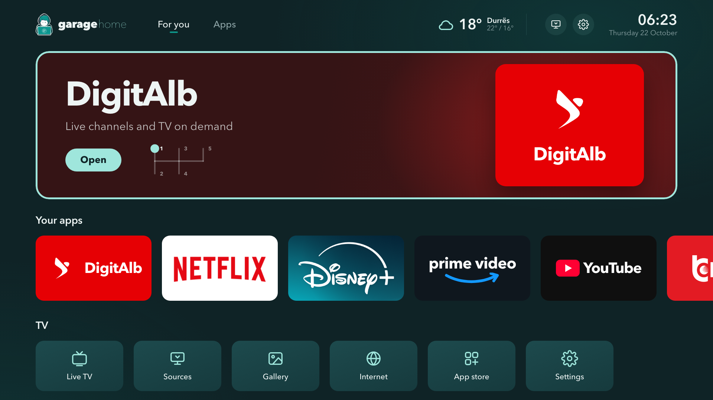
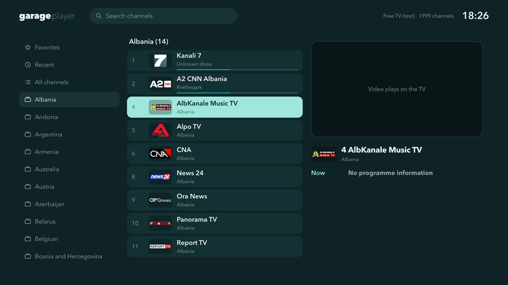

<p align="center">
  
</p>
<h1 align="center"><b>garage</b>home</h1>
<p align="center"><strong>A fast, Android TV-style home screen for Samsung Tizen TVs.</strong></p>
<p align="center">Widgets, quick controls, a task manager, kids lock and a built-in IPTV player — giving older Samsung TVs a second life.</p>
<p align="center">
  <a href="#features">Features</a> ·
  <a href="#garage-player">Garage Player</a> ·
  <a href="#requirements">Requirements</a> ·
  <a href="#build-and-install">Build and install</a> ·
  <a href="#debloat">Debloat</a> ·
  <a href="#compatibility">Compatibility</a> ·
  <a href="#license">License</a>
</p>

Garage Home replaces the Samsung bar with a full-screen launcher you drive with the remote. It opens when the TV turns on and when you press **Home**, shows your apps in the order you choose, and puts the things you actually use one press away. It is built on top of [Vetro](https://github.com/andrearicci93/vetro), which provides the root service that makes Home-button handling, quick controls and the task manager possible.

<p align="center">
  
  <br><em>Garage Home on a Samsung Q60A (desktop preview).</em>
</p>

## Features

- **Your apps, your order.** Rearrange the home row from the remote; a lazy-loaded full app grid holds everything else.
- **Widgets.** Clock, weather with a 5-day forecast, and a Today row with news, holidays, exchange rates and a phone remote.
- **Ambient mode.** A photo screensaver when the TV sits idle.
- **Quick controls.** Mute, volume, brightness and a sleep timer — without opening Samsung's menus.
- **Task manager.** See what is running and close background apps to free memory.
- **Kids lock.** PIN-protect chosen apps.
- **Home button and power-on.** The remote's Home key and TV power-on bring you back to Garage Home.
- **Light.** Around 80 MB of RAM fresh, written for the TV's Chromium 76 engine.

## Garage Player

Garage Home ships with **Garage Player**, an IPTV player for M3U and Xtream playlists. It is also available on its own: [**garage-player**](https://github.com/zerodevb/garage-player).

<p align="center">
  
</p>

- M3U links and Xtream logins, folders, favourites and search
- EPG (XMLTV, gzip supported) with now/next on the channel overlay
- Add a playlist from your phone by scanning a QR code
- PIN locks, with adult groups locked automatically
- OK shows the channel overlay, hold OK for options, Back hides the info bar first

## Requirements

- A Samsung Tizen TV with **Developer Mode** enabled and **Tizen Studio** (TV Extensions + Samsung Certificate Extension) on your computer.
- A Samsung **certificate profile** for signing.
- **Vetro with the Garage additions** for Home-button handling, quick controls, the task manager, the phone QR inbox and the playlist proxy. Use the preserved fork: [zerodevb/vetro](https://github.com/zerodevb/vetro) — branch `garage`, based on upstream commit [`e8553f2`](https://github.com/andrearicci93/vetro/commit/e8553f2) (tag `upstream-e8553f2`). Follow Vetro's own [installation guide](https://github.com/andrearicci93/vetro/blob/main/app/docs/INSTALLATION.md).

Without Vetro, Garage Home and Garage Player still run as normal apps; the root-powered features simply report that Vetro is unavailable.

## Build and install

> **Using Claude Code?** Open this folder and ask *"install Garage Home on my TV"* — [CLAUDE.md](CLAUDE.md) walks Claude through every step with you.

```bash
cp garage.env.example garage.env     # set TV, CERT_DIR and KEYCHAIN_SERVICE
(cd tools/signing && npm ci --ignore-scripts)
./build-launcher.sh                  # builds and installs Garage Home
./build-player.sh                    # builds and installs Garage Player
```

`garage.env` is git-ignored. Signing passwords are read from the macOS Keychain (`KEYCHAIN_SERVICE`, accounts `author` and `distributor`). The build writes the TV's IP (for phone QR codes) and the optional `GARAGE_PLACE` weather location into `garage-config.js`.

You can preview both apps in a desktop browser by opening `launcher/index.html` or `player/index.html`.

## Debloat

`tools/garage-debloat.mjs` uses Vetro's API to switch off voice assistants, ads, ambient services and other background components you do not use, freeing RAM and CPU on older TVs. It is a dry run by default and saves a restore file before changing anything.

```bash
TV=192.168.1.50 node tools/garage-debloat.mjs              # show what would change
TV=192.168.1.50 node tools/garage-debloat.mjs --apply      # apply (add --extras for more)
TV=192.168.1.50 node tools/garage-debloat.mjs --restore debloat-restore-<date>.json
```

On the test TV, free RAM went from about 534 MB to about 690 MB. Results depend on your model and what was running.

## Compatibility

| TV | Firmware | Status |
| --- | --- | --- |
| **Q60A — QE75Q60AAUXZT**, Tizen 6 | T-NKLADEUC-2030.1 | **Tested on one TV** |
| Other Tizen 6+ Samsung TVs supported by Vetro | — | Untested; should work where Vetro works |

Tried it on another model? Open an issue with the model, firmware and what worked.

## Credits

- [Vetro](https://github.com/andrearicci93/vetro) by Andrea Ricci (MIT) — root service, TV API and signing tools.
- [qrcode-generator](https://github.com/kazuhikoarase/qrcode-generator) (MIT) and [pako](https://github.com/nodeca/pako) (MIT).

## License

[PolyForm Noncommercial 1.0.0](LICENSE). Free to use, modify and share for any noncommercial purpose; **selling it or using it commercially is not allowed** without permission. Vetro and the bundled libraries keep their own MIT licenses.

<p align="center"><br>Powered by <a href="https://thegaragedevs.com"><b>TheGarageDevs.com</b></a></p>
